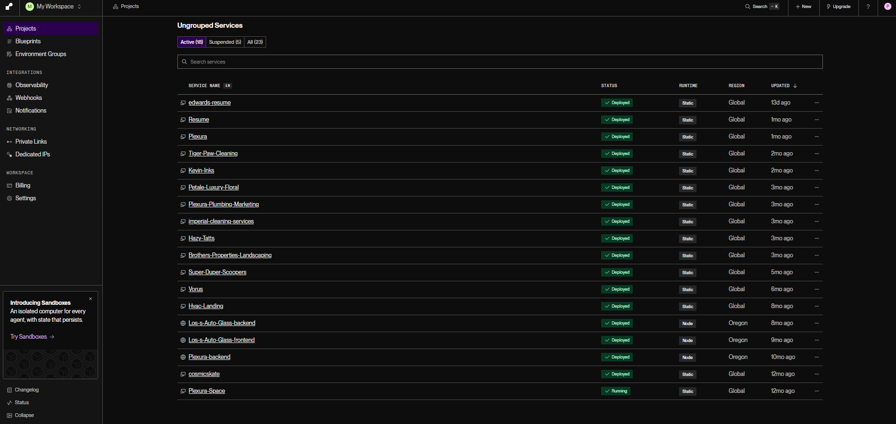
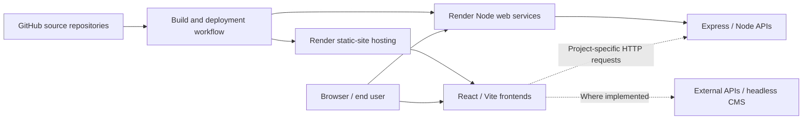

<div align="center">


# Production Application Deployments

### Web Applications · Backend Services · Cloud Hosting · Deployment Operations

**Brandon Stevenson**  
IT Infrastructure · Software Programming · Application Deployment

[Portfolio & Resume](https://www.brandons-resume.com/) &nbsp;·&nbsp; [GitHub](https://github.com/brandon-in-tech) &nbsp;·&nbsp; [LinkedIn](https://www.linkedin.com/in/brandon-in-tech/)

---

*A technical portfolio documenting independently developed and deployed websites, full-stack applications, backend services, and the operational workflows used to publish and support them.*

</div>

## 1. Overview

This repository consolidates evidence of **application development, production-oriented deployments, and web service hosting** across a collection of personal projects, client-facing websites, and application demonstrations.

My background combines software programming with hands-on IT infrastructure and systems administration. The goal of this portfolio is to make that intersection visible: building application components, deploying them to hosted environments, managing frontend/backend separation where required, and diagnosing issues between source code and a working deployment.

The work represented here includes:

- **Static frontend deployments:** React, Vite, TypeScript/JavaScript, responsive interfaces, and production builds.
- **Node.js web services:** backend/API components and applications that require a running server environment.
- **Full-stack architecture:** distinct frontend and backend codebases, REST integration, forms, scheduling, and service workflows where supported by the original projects.
- **Third-party systems:** API integrations and content-management workflows, including a headless WordPress project.
- **Deployment operations:** hosting configuration, builds, environment management, DNS/domain integration, validation, and troubleshooting.

> **Scope:** This is a portfolio and implementation index, **not** an assertion that Render infrastructure itself was manually provisioned or that all projects use the same stack. Render is a managed hosting platform; underlying server orchestration, scaling, and platform security are outside the scope of the implementations documented here.

## 2. Deployment Dashboard

<div align="center">



<sub>Render workspace overview · point-in-time deployment screenshot · application and service availability may change.</sub>

</div>

The original dashboard capture supplied for this portfolio showed **23 total services**, with **18 active** and **5 suspended**. Within its active list were **15 Static services** and **3 Node services**. These are counts of hosting **services**, not a claim of 23 unique applications or 23 independently verified production businesses.

The three Node services visible in that original capture were:

| Render service | Runtime shown | Region shown | Project relationship |
| --- | --- | --- | --- |
| `Los-s-Auto-Glass-backend` | Node | Oregon | Auto-glass application backend |
| `Los-s-Auto-Glass-frontend` | Node | Oregon | Auto-glass application frontend |
| `Plexura-backend` | Node | Oregon | Plexura application/API service |

The remaining active entries were predominantly static websites and frontend deployments. Service statuses and update times are intentionally **not** presented as real-time monitoring data.

> **Evidence integrity:** Use an unaltered dashboard capture when presenting deployed-service counts or service status as factual evidence. If the image has been edited for visual presentation, label it as an illustration and keep verified counts separate from the illustration.

## 3. Featured Applications & Source Code

The entries below summarize publicly available **application source code**, including project manifests (`package.json`), source organization, and documented features. Stack information is specific to each repository. Render service types are based on the **original unedited dashboard screenshot**, rather than inferred from files in GitHub. These are brief engineering summaries, not claims that every dependency or planned integration is active in production.

### 1. Los Auto & Glass — Full-Stack Booking Application

**[Source repository](https://github.com/brandon-in-tech/Los-s-Auto-Glass-)** · [Frontend package](https://github.com/brandon-in-tech/Los-s-Auto-Glass-/blob/main/frontend/package.json) · [Backend package](https://github.com/brandon-in-tech/Los-s-Auto-Glass-/blob/main/backend/package.json) · [Public business website](https://www.kcknglass.com/)

**Stack:** Next.js 14, React, TypeScript, Tailwind CSS, Framer Motion, Zustand; Node.js, Express, TypeScript, Mongoose/MongoDB integration, CORS, Helmet, JSON Web Token and validation libraries. The source also declares PayPal UI, Nodemailer, Twilio and scheduled-task dependencies.

A separated `frontend/` and `backend/` application for auto-glass service discovery and booking. The actual [`backend/src/server.ts`](https://github.com/brandon-in-tech/Los-s-Auto-Glass-/blob/main/backend/src/server.ts) registers authentication, services, bookings, calendar, payment, contact, administration and SMS routes, a health-check endpoint, rate limiting, CORS and security headers. **Render evidence:** `Los-s-Auto-Glass-frontend` and `Los-s-Auto-Glass-backend` are two distinct **Node** services.

### 2. Plexura — Agency Website & Contact API Integration

**[Source repository](https://github.com/brandon-in-tech/Plexura)** · [Package manifest](https://github.com/brandon-in-tech/Plexura/blob/main/package.json) · [Website](https://plexura.net/)

**Stack:** React 18, JavaScript/JSX, Vite 6, React Router, Tailwind CSS 3, Framer Motion, Lucide React and Three.js. The frontend documentation describes REST/Fetch API communication for contact submissions.

A responsive business website with routed pages, component-based layouts and interactive effects. The source includes optional animation-worker functionality with a fallback. Its [`src/App.jsx`](https://github.com/brandon-in-tech/Plexura/blob/main/src/App.jsx) implements `POST /api/contact` using a configurable `VITE_API_URL` and a Render-hosted default endpoint. **Render evidence:** a `Plexura` **Static** service and a separate `Plexura-backend` **Node** service. The public frontend identifies the intended API endpoint but does not independently verify the backend's internal implementation or current runtime health.

### 3. Kevin Inks — Headless WordPress Portfolio

**[Source repository](https://github.com/brandon-in-tech/Kevin-Inks)** · [Package manifest](https://github.com/brandon-in-tech/Kevin-Inks/blob/main/package.json) · [Project website](https://kevin-inks.vercel.app/)

**Stack:** React 18, TypeScript, Vite 5, Tailwind CSS 3, Framer Motion and a **headless WordPress** content-management integration. The repository also contains a `wordpress-plugin/` directory.

A custom tattoo portfolio with artwork galleries, design availability and consultation calls to action. WordPress provides editable content while React controls the presentation. **Render evidence:** `Kevin-Inks` appears as **Static**; the repository also advertises a Vercel address, which should not be confused with the Render service.

### 4. Tiger Paw Cleaning — Responsive Client Website

**[Source repository](https://github.com/brandon-in-tech/Tiger-Paw-Cleaning)** · [Package manifest](https://github.com/brandon-in-tech/Tiger-Paw-Cleaning/blob/main/package.json) · [Website](https://www.tigerpawcleaning.com/)

**Stack:** React, TypeScript, Vite 6, Tailwind CSS 4, Motion and UI-component libraries including Radix UI/MUI packages in the dependency manifest.

A service-focused cleaning business site featuring responsive layouts, animated presentation, service information and a quote/contact workflow. The dependency manifest is broad, so listed libraries do not necessarily imply every component is actively used. **Render evidence:** `Tiger-Paw-Cleaning` **Static** service; no independently verified Node backend.

### 5. Hazy Tatts — Artist Portfolio & Booking Inquiry

**[Source repository](https://github.com/brandon-in-tech/Hazy-Tatts)** · [Package manifest](https://github.com/brandon-in-tech/Hazy-Tatts/blob/main/package.json) · [Website](https://www.hazeytattoos.com/)

**Stack:** React 18, JavaScript/JSX, **Create React App / react-scripts 5**, custom CSS, native browser animation APIs and **Web3Forms** for booking inquiries. Unlike several other sites, this repository does **not** use Vite/Tailwind as its primary build/styling stack.

A filterable portfolio with gallery lightboxes, responsive navigation and inquiry forms. **Render evidence:** `Hazy-Tatts` **Static** service. Web3Forms is an external form service—not proof of a separately hosted backend.

### 6. Imperial Cleaning Services — Component-Based Business Website

**[Source repository](https://github.com/brandon-in-tech/imperial-cleaning-services)** · [Package manifest](https://github.com/brandon-in-tech/imperial-cleaning-services/blob/main/package.json)

**Stack:** React, JavaScript/JSX, Vite, Tailwind CSS and Framer Motion.

An editorial-style commercial cleaning website with reusable components, service-sector presentation, navigation interactions and contact content. Its README documents refactoring from a larger component into **13 focused UI components**. **Render evidence:** `imperial-cleaning-services` **Static** service.

### 7. Super Duper Scoopers — Multi-Page Service Website

**[Source repository](https://github.com/brandon-in-tech/Super-Duper-Scoopers)** · [Package manifest](https://github.com/brandon-in-tech/Super-Duper-Scoopers/blob/main/package.json) · [Demo](https://super-duper-scoopers.onrender.com/)

**Stack:** React, JavaScript/JSX, Vite, Tailwind CSS, Framer Motion and React Router.

A three-page website (Home, About, Contact) with responsive navigation, page transitions, animations, centralized content and a validated contact-form interface. **Render evidence:** `Super-Duper-Scoopers` **Static** service.

### 8. Brandon's Interactive Resume — Developer & IT Portfolio

**[Source repository](https://github.com/brandon-in-tech/Resume)** · [Package manifest](https://github.com/brandon-in-tech/Resume/blob/main/package.json) · [Website](https://www.brandons-resume.com/)

**Stack:** React 18, TypeScript, Vite, Tailwind CSS, Framer Motion, **Three.js** and Lucide React.

An interactive technical résumé with animated sections and a 3D Saturn-themed visual environment. It connects the development portfolio with professional IT infrastructure work. **Render evidence:** `Resume` **Static** service.

### 9. Cosmic Skate — Animated Frontend Concept

**[Source repository](https://github.com/brandon-in-tech/cosmicskate)** · [Package manifest](https://github.com/brandon-in-tech/cosmicskate/blob/main/package.json) · [Demo](https://cosmicskate.onrender.com/)

**Stack:** React 18, JavaScript/JSX, Vite 5, **Three.js** and Framer Motion.

A galaxy-themed business frontend demonstration built around motion and visual interaction. The published source focuses on bringing a creative visual concept into a responsive browser experience. **Render evidence:** `cosmicskate` **Static** service.

### 10. Vorus — Fictional Luxury Brand Concept

**[Source repository](https://github.com/brandon-in-tech/Vorus)** · [Client package](https://github.com/brandon-in-tech/Vorus/blob/main/client/package.json) · [Server package](https://github.com/brandon-in-tech/Vorus/blob/main/server/package.json) · [Demo](https://vorus.onrender.com/)

**Stack:** React 18, TypeScript, Vite, Tailwind CSS, Framer Motion, Lucide React; a **separate Express.js + Mongoose server** is present in the public source.

A fictional product-brand showcase emphasizing landing-page experience and custom product visuals. It includes `client/` and `server/` code, but the original screenshot verifies **only the `Vorus` Static deployment**. The Express/Mongoose source should not be presented as a confirmed live Render backend.

> **Source coverage:** These are the web-development repositories whose public code/manifests I could inspect and relate to this portfolio. A Render service with no verified corresponding public repository is listed separately in the inventory below, without guessing its stack. This is not a claim that every repository in the GitHub account is a hosted web application.

## 4. Other Services Observed in the Dashboard

The original screenshot also lists the following active services. These entries are included as a **deployment inventory**, without inventing technologies, application features, public repositories, or ownership details not established by the screenshot.

| Service name | Type shown | Source status |
| --- | --- | --- |
| `edwards-resume` | Static | Source repository not verified in this review |
| `Petale-Luxury-Floral` | Static | Source repository not verified in this review |
| `Plexura-Plumbing-Marketing` | Static | Source repository not verified in this review |
| `Brothers-Properties-Landscaping` | Static | Source repository not verified in this review |
| `Hvac-Landing` | Static | Source repository not verified in this review |
| `Plexura-Space` | Static | Source repository not verified in this review |

As additional project documentation becomes available, individual entries can be expanded with source links, technical summaries, diagrams, and approved screenshots.

## 5. Application Delivery Architecture

The following diagram summarizes **patterns represented by the documented projects**. It is an architecture overview, not an export of a specific account's private Render settings.



**Architecture notes**

1. Static deployments deliver compiled frontend assets; they do not require a persistent Node runtime to serve application code.
2. Node web services execute application code in a managed runtime and may expose HTTP endpoints.
3. A single application can be represented by multiple deployed services, as with Los Auto & Glass.
4. A frontend may integrate with a separately hosted backend or third-party service; the implementation is project-specific.
5. A custom domain or linked repository does not, on its own, establish that a particular deployment is currently healthy or serving live production traffic.

## 6. Deployment & Operational Workflow

This section documents the general workflow used across the application portfolio, rather than asserting that every project uses identical build commands or platform configuration.

| Stage | Technical work | Verification or evidence |
| --- | --- | --- |
| **1. Source control** | Maintain project source, dependencies, and revisions with Git/GitHub | Repository tree, commits, branch history |
| **2. Build preparation** | Confirm framework-specific build scripts and runtime requirements | Successful local or hosted build output |
| **3. Service configuration** | Select static hosting or Node runtime based on application architecture | Render service type and configuration (sanitized) |
| **4. Environment settings** | Configure required nonsecret values and supply secrets through platform-managed environment settings | Redacted configuration names, never values |
| **5. Deployment** | Publish builds and investigate deployment failures | Deployment history, redacted build logs |
| **6. Application validation** | Open frontend routes and, where applicable, verify expected API behavior | Browser checks, appropriate endpoint tests |
| **7. Domain integration** | Map public/custom domains and review DNS or HTTPS behavior when applicable | Public DNS/website checks, sanitized evidence |
| **8. Maintenance** | Update code, dependencies, or content and troubleshoot regressions | Commit history, issue notes, test results |

### Common failure categories

- **Build failures:** missing dependency, incompatible runtime version, TypeScript or bundler errors, incorrect build directory.
- **Application startup failures:** missing start command, incorrect listening port, invalid environment configuration, or backend exceptions.
- **Frontend/API issues:** incorrect API base URL, CORS policy mismatch, failed HTTP requests, unavailable third-party dependencies.
- **Routing problems:** SPA fallback/rewrite misconfiguration or incorrect client-side route handling.
- **Domain and certificate issues:** invalid DNS records, incomplete domain verification, or HTTPS configuration delays.

These are relevant troubleshooting categories, **not claims that each incident occurred** in every deployment shown.

## 7. Security, Privacy & Evidence Handling

This repository is intended to be **public-safe documentation**.

- Do not include `.env` files, access tokens, API keys, service credentials, customer records, or private configuration values.
- Redact identifiers and operational details in screenshots unless they are intentionally public.
- Link to public source repositories only; private application source and client integrations remain outside this repository.
- Use client screenshots, brand assets, and project details only when authorized for public presentation.
- Distinguish **deployed**, **running**, **suspended**, and **historically deployed** states accurately.
- Do not treat dashboard service counts as application counts, uptime guarantees, or proof of SLA compliance.

## 8. Repository Structure

```text
Production-Application-Deployments/
├── README.md
└── assets/
    ├── brandons-logo.png
    └── render-dash.png
```

**File naming:** The image references above assume your existing assets are named exactly `brandons-logo.png` and `render-dash.png` (lowercase). If their actual extensions differ, update the two paths in this README.

This repository can be extended later with `docs/` and additional approved application screenshots; no empty directories or invented evidence are required for the initial publication.

## 9. Related Infrastructure & Automation Work

My application-hosting experience complements other documented work in [enterprise networking, systems administration, and automation](https://github.com/brandon-in-tech), including:

- [Microsoft 365 Help Desk Automation](https://github.com/brandon-in-tech/Microsoft-365-HelpDesk-Automation) — PowerShell and Microsoft Graph tooling.
- [Cisco Nexus 5596UP Infrastructure Project](https://github.com/brandon-in-tech/Cisco-Nexus-5596UP-Infrastructure-Project) — data-center switch recovery and validation.
- [Cisco Catalyst 2960-X Infrastructure Project](https://github.com/brandon-in-tech/Cisco-Catalyst-2960X-Hands-On-Infrastructure-Project) — network-device recovery and secure servicing.

This broader portfolio reflects an interest in the **complete technology stack**: physical infrastructure, operating systems, networks, identity, automation, and the applications that run on top.

---

<div align="center">


**Brandon Stevenson**  
IT Infrastructure · Software Programming · Application Deployment

[Portfolio & Resume](https://www.brandons-resume.com/) &nbsp;·&nbsp; [LinkedIn](https://www.linkedin.com/in/brandon-in-tech/) &nbsp;·&nbsp; [GitHub](https://github.com/brandon-in-tech)

*Technical implementations, deployment documentation, and project evidence.*

</div>
