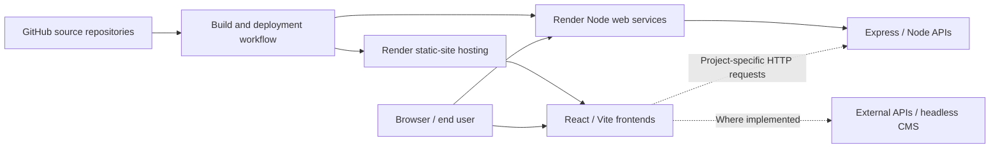

<div align="center">


# Production Application Deployments

### Web Applications · Backend Services · Cloud Hosting · Deployment Operations

**Brandon Stevenson**  
IT Infrastructure · Software Programming · Application Deployment

[Portfolio & Resume](https://www.brandons-resume.com/) &nbsp;·&nbsp; [GitHub](https://github.com/brandon-in-tech) &nbsp;·&nbsp; [LinkedIn](https://www.linkedin.com/in/brandon-in-tech/)

---

*A technical portfolio documenting independently developed and deployed websites, full-stack applications, backend services, and the operational workflows used to publish and support them.*

</div>

## 01 · Overview

This repository consolidates evidence of **application development, production-oriented deployments, and web service hosting** across a collection of personal projects, client-facing websites, and application demonstrations.

My background combines software programming with hands-on IT infrastructure and systems administration. The goal of this portfolio is to make that intersection visible: building application components, deploying them to hosted environments, managing frontend/backend separation where required, and diagnosing issues between source code and a working deployment.

The work represented here includes:

- **Static frontend deployments:** React, Vite, TypeScript/JavaScript, responsive interfaces, and production builds.
- **Node.js web services:** backend/API components and applications that require a running server environment.
- **Full-stack architecture:** distinct frontend and backend codebases, REST integration, forms, scheduling, and service workflows where supported by the original projects.
- **Third-party systems:** API integrations and content-management workflows, including a headless WordPress project.
- **Deployment operations:** hosting configuration, builds, environment management, DNS/domain integration, validation, and troubleshooting.

> **Scope:** This is a portfolio and implementation index, **not** an assertion that Render infrastructure itself was manually provisioned or that all projects use the same stack. Render is a managed hosting platform; underlying server orchestration, scaling, and platform security are outside the scope of the implementations documented here.

## 02 · Deployment Dashboard

<div align="center">


<sub>Render workspace overview · point-in-time deployment screenshot · application and service availability may change.</sub>

</div>

The original dashboard capture supplied for this portfolio showed **23 total services**, with **18 active** and **5 suspended**. Within its active list were **15 Static services** and **3 Node services**. These are counts of hosting **services**, not a claim of 23 unique applications or 23 independently verified production businesses.

The three Node services visible in that original capture were:

| Render service | Runtime shown | Region shown | Project relationship |
| --- | --- | --- | --- |
| `Los-s-Auto-Glass-backend` | Node | Oregon | Auto-glass application backend |
| `Los-s-Auto-Glass-frontend` | Node | Oregon | Auto-glass application frontend |
| `Plexura-backend` | Node | Oregon | Plexura application/API service |

The remaining active entries were predominantly static websites and frontend deployments. Service statuses and update times are intentionally **not** presented as real-time monitoring data.

> **Evidence integrity:** Use an unaltered dashboard capture when presenting deployed-service counts or service status as factual evidence. If the image has been edited for visual presentation, label it as an illustration and keep verified counts separate from the illustration.

## 03 · Featured Implementations

The projects below were selected because their public source repositories provide useful detail about architecture, technologies, or application features. **GitHub sources establish the project implementations; the Render dashboard independently establishes the service names shown at the time of capture.** They should not be treated as interchangeable evidence of every feature being operational in production.

### A. Los Auto & Glass — Frontend / Backend Application

**Repository:** [Los-s-Auto-Glass-](https://github.com/brandon-in-tech/Los-s-Auto-Glass-)  
**Public project website listed in the repository:** [kcknglass.com](https://www.kcknglass.com/)

The project is organized into separate `frontend/` and `backend/` directories. Its repository documents a **Next.js 14 + TypeScript frontend** and an **Express.js + TypeScript backend**, including a service-booking experience, contact workflows, and a customer-facing appointment flow. Its README also references PayPal integration and calendar-based booking.

**Deployment evidence:** The original Render dashboard lists separate Node services for the frontend and backend. This is the clearest example in the portfolio of a two-service application deployment.

**Skills demonstrated:** multi-service deployment organization, frontend/API separation, server-based hosting, environment configuration, and diagnosing interactions between user-facing pages and backend services.

### B. Plexura — Agency Website and API Integration

**Repository:** [Plexura](https://github.com/brandon-in-tech/Plexura)  
**Public project website:** [plexura.net](https://plexura.net/)

Plexura is a responsive React single-page website built with **Vite, JavaScript/JSX, React Router, Tailwind CSS, and Framer Motion**. Its public README describes a configurable **REST API integration for contact-form submissions**, client-side routing, and reusable UI components.

**Deployment evidence:** The dashboard includes a `Plexura` static deployment and a separately listed `Plexura-backend` Node service. The screenshot does not independently prove that every frontend request reaches that specific backend service; deployment configuration and runtime logs would be the appropriate evidence for that claim.

**Skills demonstrated:** frontend build and delivery, service separation, form-to-API integration, routing, application deployment, and maintenance of an agency website.

### C. Kevin Inks — Headless CMS Integration

**Repository:** [Kevin-Inks](https://github.com/brandon-in-tech/Kevin-Inks)  
**Public website listed in the repository:** [kevin-inks.vercel.app](https://kevin-inks.vercel.app/)

A tattoo portfolio and inquiry experience with a custom **React frontend** and **headless WordPress content management**. The public repository documents an approach that lets the artist update portfolio material and other content through WordPress while the website retains a custom frontend.

**Deployment evidence:** `Kevin-Inks` appears as a Static service in the Render screenshot. The repository separately advertises a Vercel URL, illustrating that **source code, custom domains, and deployed environments should be tracked individually** rather than assumed to point to one platform.

**Skills demonstrated:** frontend/content separation, third-party CMS integration, content-driven interfaces, and deployment environment awareness.

### D. Tiger Paw Cleaning — Client Website

**Repository:** [Tiger-Paw-Cleaning](https://github.com/brandon-in-tech/Tiger-Paw-Cleaning)  
**Public project website:** [tigerpawcleaning.com](https://www.tigerpawcleaning.com/)

A client-facing website built with **React, TypeScript, Vite, Tailwind CSS, and Framer Motion**. The documented features include responsive layouts, a service showcase, animation, and a contact/quote inquiry experience.

**Deployment evidence:** `Tiger-Paw-Cleaning` appears in the dashboard's active static services. No dedicated backend for this project was established by the original dashboard capture.

**Skills demonstrated:** frontend production builds, responsive delivery, client-oriented website maintenance, and publishing a business-facing interface.

### E. Hazy Tatts — Portfolio and Booking Inquiry

**Repository:** [Hazy-Tatts](https://github.com/brandon-in-tech/Hazy-Tatts)  
**Public project website:** [hazeytattoos.com](https://www.hazeytattoos.com/)

A React single-page portfolio with a filterable gallery, responsive navigation, lightbox interaction, and a booking inquiry form. The public project documentation identifies **Web3Forms** for serverless form submission.

**Deployment evidence:** `Hazy-Tatts` appears as an active Static service. Its use of a third-party form service should **not** be described as a separately deployed Node backend.

**Skills demonstrated:** static hosting, third-party API communication, UX interactions, and deployment of interactive frontend features.

### F. Imperial Cleaning Services — Component-Based Site

**Repository:** [imperial-cleaning-services](https://github.com/brandon-in-tech/imperial-cleaning-services)

A React/Vite/Tailwind/Framer Motion website organized around reusable components, section-based presentation, and a contact workflow. Its repository documents a redesign from a larger single-component approach toward more focused components.

**Deployment evidence:** `imperial-cleaning-services` appears as an active Static service.

**Skills demonstrated:** frontend organization, production bundling, UI component maintenance, and application delivery.

### G. Super Duper Scoopers — Multi-Page Marketing Website

**Repository:** [Super-Duper-Scoopers](https://github.com/brandon-in-tech/Super-Duper-Scoopers)  
**Public Render site:** [super-duper-scoopers.onrender.com](https://super-duper-scoopers.onrender.com/)

A React/Vite/Tailwind/Framer Motion website with **React Router**, mobile navigation, animated transitions, centralized editable content, and a validated contact form.

**Deployment evidence:** `Super-Duper-Scoopers` appears in the active Static service list.

**Skills demonstrated:** production SPA delivery, client-side routing, responsive interface behavior, and deployment validation.

### H. Personal Portfolio and Creative Demonstrations

| Project | Public repository | Deployment / purpose |
| --- | --- | --- |
| **Personal Resume** | [Resume](https://github.com/brandon-in-tech/Resume) | Interactive professional portfolio; listed as `Resume` in Render; [public site](https://www.brandons-resume.com/) |
| **Cosmic Skate** | [cosmicskate](https://github.com/brandon-in-tech/cosmicskate) | Galaxy-themed frontend concept; [Render site](https://cosmicskate.onrender.com/) |
| **Vorus** | [Vorus](https://github.com/brandon-in-tech/Vorus) | **Fictional** luxury-fragrance product/website concept; [Render site](https://vorus.onrender.com/) |

The Vorus repository documents React/TypeScript frontend development and an Express backend in its source architecture, but the original dashboard shows only a `Vorus` **Static** service. This portfolio does **not** present the corresponding Express server as a separately verified Render deployment.

## 04 · Other Services Observed in the Dashboard

The original screenshot also lists the following active services. These entries are included as a **deployment inventory**, without inventing technologies, application features, public repositories, or ownership details not established by the screenshot.

| Service name | Type shown | Source status |
| --- | --- | --- |
| `edwards-resume` | Static | Source repository not verified in this review |
| `Petale-Luxury-Floral` | Static | Source repository not verified in this review |
| `Plexura-Plumbing-Marketing` | Static | Source repository not verified in this review |
| `Brothers-Properties-Landscaping` | Static | Source repository not verified in this review |
| `Hvac-Landing` | Static | Source repository not verified in this review |
| `Plexura-Space` | Static | Source repository not verified in this review |

As additional project documentation becomes available, individual entries can be expanded with source links, technical summaries, diagrams, and approved screenshots.

## 05 · Application Delivery Architecture

The following diagram summarizes **patterns represented by the documented projects**. It is an architecture overview, not an export of a specific account's private Render settings.



**Architecture notes**

1. Static deployments deliver compiled frontend assets; they do not require a persistent Node runtime to serve application code.
2. Node web services execute application code in a managed runtime and may expose HTTP endpoints.
3. A single application can be represented by multiple deployed services, as with Los Auto & Glass.
4. A frontend may integrate with a separately hosted backend or third-party service; the implementation is project-specific.
5. A custom domain or linked repository does not, on its own, establish that a particular deployment is currently healthy or serving live production traffic.

## 06 · Deployment & Operational Workflow

This section documents the general workflow used across the application portfolio, rather than asserting that every project uses identical build commands or platform configuration.

| Stage | Technical work | Verification or evidence |
| --- | --- | --- |
| **1 · Source control** | Maintain project source, dependencies, and revisions with Git/GitHub | Repository tree, commits, branch history |
| **2 · Build preparation** | Confirm framework-specific build scripts and runtime requirements | Successful local or hosted build output |
| **3 · Service configuration** | Select static hosting or Node runtime based on application architecture | Render service type and configuration (sanitized) |
| **4 · Environment settings** | Configure required nonsecret values and supply secrets through platform-managed environment settings | Redacted configuration names, never values |
| **5 · Deployment** | Publish builds and investigate deployment failures | Deployment history, redacted build logs |
| **6 · Application validation** | Open frontend routes and, where applicable, verify expected API behavior | Browser checks, appropriate endpoint tests |
| **7 · Domain integration** | Map public/custom domains and review DNS or HTTPS behavior when applicable | Public DNS/website checks, sanitized evidence |
| **8 · Maintenance** | Update code, dependencies, or content and troubleshoot regressions | Commit history, issue notes, test results |

### Common failure categories

- **Build failures:** missing dependency, incompatible runtime version, TypeScript or bundler errors, incorrect build directory.
- **Application startup failures:** missing start command, incorrect listening port, invalid environment configuration, or backend exceptions.
- **Frontend/API issues:** incorrect API base URL, CORS policy mismatch, failed HTTP requests, unavailable third-party dependencies.
- **Routing problems:** SPA fallback/rewrite misconfiguration or incorrect client-side route handling.
- **Domain and certificate issues:** invalid DNS records, incomplete domain verification, or HTTPS configuration delays.

These are relevant troubleshooting categories, **not claims that each incident occurred** in every deployment shown.

## 07 · Security, Privacy & Evidence Handling

This repository is intended to be **public-safe documentation**.

- Do not include `.env` files, access tokens, API keys, service credentials, customer records, or private configuration values.
- Redact identifiers and operational details in screenshots unless they are intentionally public.
- Link to public source repositories only; private application source and client integrations remain outside this repository.
- Use client screenshots, brand assets, and project details only when authorized for public presentation.
- Distinguish **deployed**, **running**, **suspended**, and **historically deployed** states accurately.
- Do not treat dashboard service counts as application counts, uptime guarantees, or proof of SLA compliance.

## 08 · Repository Structure

```text
Production-Application-Deployments/
├── README.md
└── assets/
    ├── brandons-logo.png
    └── render-dash.png
```

**File naming:** The image references above assume your existing assets are named exactly `brandons-logo.png` and `render-dash.png` (lowercase). If their actual extensions differ, update the two paths in this README.

This repository can be extended later with `docs/` and additional approved application screenshots; no empty directories or invented evidence are required for the initial publication.

## 09 · Related Infrastructure & Automation Work

My application-hosting experience complements other documented work in [enterprise networking, systems administration, and automation](https://github.com/brandon-in-tech), including:

- [Microsoft 365 Help Desk Automation](https://github.com/brandon-in-tech/Microsoft-365-HelpDesk-Automation) — PowerShell and Microsoft Graph tooling.
- [Cisco Nexus 5596UP Infrastructure Project](https://github.com/brandon-in-tech/Cisco-Nexus-5596UP-Infrastructure-Project) — data-center switch recovery and validation.
- [Cisco Catalyst 2960-X Infrastructure Project](https://github.com/brandon-in-tech/Cisco-Catalyst-2960X-Hands-On-Infrastructure-Project) — network-device recovery and secure servicing.

This broader portfolio reflects an interest in the **complete technology stack**: physical infrastructure, operating systems, networks, identity, automation, and the applications that run on top.

---

<div align="center">


**Brandon Stevenson**  
IT Infrastructure · Software Programming · Application Deployment

[Portfolio & Resume](https://www.brandons-resume.com/) &nbsp;·&nbsp; [LinkedIn](https://www.linkedin.com/in/brandon-in-tech/) &nbsp;·&nbsp; [GitHub](https://github.com/brandon-in-tech)

*Technical implementations, deployment documentation, and project evidence.*

</div>
